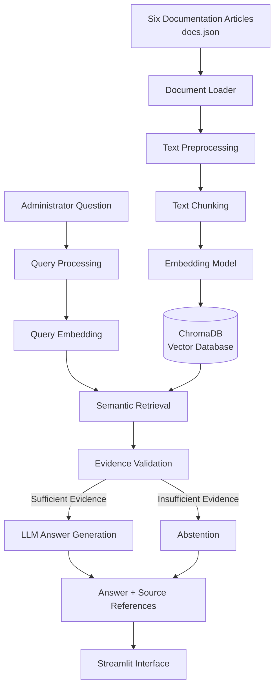

# Solstice Learning – Document Question-Answering Assistant

## 1. Project Overview

The objective of this project is to develop an AI-powered Document Question-Answering Assistant for Solstice Learning, an online-course platform serving corporate customers.

The company maintains documentation covering various platform functionalities, including password management, course exports, billing cycles, and administrator management. However, administrators find it difficult to navigate through multiple documentation pages to locate relevant information.

The proposed solution is a Retrieval-Augmented Generation (RAG) based assistant that allows administrators to ask questions in natural language and receive accurate answers grounded in the available documentation.

A key design requirement is reliability. The system must not generate unsupported answers using the LLM's general knowledge. If the documentation does not contain sufficient evidence, the assistant must explicitly abstain from answering.

## 2. Proposed Solution

The proposed system consists of two major components:

1. **RAG Backend (`rag_backend.py`):** Handles document ingestion, preprocessing, chunking, embedding generation, vector storage, retrieval, evidence validation, and answer generation.

2. **Streamlit Frontend (`app.py`):** Provides an interactive interface for asking questions, viewing generated answers, and evaluating the system against predefined test cases.

The architecture separates document ingestion from question answering to avoid regenerating document embeddings for every user query.

## 3. System Architecture

The system consists of two primary pipelines.

### 3.1 Document Ingestion Pipeline

The ingestion pipeline processes the provided documentation articles and prepares them for semantic retrieval.

**Input:** `data/docs.json`

The pipeline consists of the following stages:

**1. Document Loading**

- Load the six documentation articles from the provided JSON file.
- Extract document IDs, titles, content, and available metadata.
- Validate the input structure and handle missing or empty content.

**2. Text Preprocessing**

- Clean unnecessary whitespace and formatting.
- Normalize text where appropriate.
- Preserve meaningful headings, sections, and document metadata.

**3. Text Chunking**

- Split documentation articles into smaller, manageable text chunks.
- Use configurable chunk sizes and overlapping regions to preserve contextual continuity.
- Maintain source document IDs and metadata for every chunk.

**4. Embedding Generation**

- Convert each text chunk into a numerical vector using an embedding model.
- Use the same embedding model for document chunks and incoming user queries.
- Ensure that semantically similar text can be retrieved even when the wording differs.

**5. Vector Storage**

- Store generated embeddings along with their original text and metadata in ChromaDB.
- Use persistent storage so document embeddings do not need to be regenerated every time the application starts.
- Rebuild or update the index when the source documents change.

**Output:** A searchable vector database containing documentation chunks, embeddings, and source metadata.

### 3.2 Question-Answering Pipeline

This pipeline executes whenever an administrator submits a question.

**Input:** A natural-language question from the user.

**1. Query Processing**

- Accept the user's question.
- Perform basic validation.
- Convert the question into an embedding using the same embedding model used during ingestion.

**2. Document Retrieval**

- Search the vector database using semantic similarity.
- Retrieve the most relevant document chunks.
- Preserve source information for every retrieved chunk.
- Optionally experiment with reranking to improve retrieval quality.

**3. Evidence Validation**

Evaluate whether the retrieved passages contain sufficient information to answer the question.

The system should consider:

- Retrieval relevance.
- Whether the retrieved passages directly support the question.
- Whether the evidence is complete.
- Whether multiple passages provide consistent information.
- Whether the retrieved information contains contradictions.

If the evidence is insufficient, the system must abstain rather than generate an unsupported answer.

For ambiguous questions, the assistant should request clarification where necessary.

**4. Answer Generation**

If sufficient evidence is available:

- Construct a context containing the retrieved passages.
- Pass the context and user question to the LLM.
- Instruct the LLM to answer strictly using the provided context.
- Prevent the model from introducing unsupported external information.
- Generate a concise, understandable response.

**5. Source Attribution**

The final response should include relevant source document titles or IDs and, where possible, the supporting passages.

**6. Final Response**

The backend returns the answer, source references, and response status to the frontend.

If sufficient evidence is unavailable, the assistant returns:

"I don't have an answer for that based on the available documentation."

## 4. Architecture Diagram

## 5. Backend Design – rag_backend.py

All core RAG functionalities will be implemented in a single Python module.

The backend will contain the following logical functions:

| Function | Responsibility |
|---|---|
| `load_documents()` | Load documentation articles from JSON |
| `preprocess_documents()` | Clean and normalize document content |
| `create_chunks()` | Split articles into smaller passages |
| `create_embeddings()` | Generate document embeddings |
| `create_vector_store()` | Create and persist the ChromaDB index |
| `retrieve_documents()` | Retrieve relevant passages for a query |
| `validate_evidence()` | Evaluate whether retrieved information is sufficient |
| `generate_answer()` | Generate answers grounded in retrieved context |
| `answer_question()` | Coordinate the complete question-answering workflow |

The `answer_question()` function will act as the primary interface between the backend and frontend.

It will return a structured response containing:

- Generated answer.
- Source references.
- Response status.
- Relevant supporting evidence, where available.

## 6. Frontend Design – app.py

The frontend will be developed using Streamlit.

It will provide three primary functionalities.

### 6.1 Ask Question

Allows administrators to:

- Enter natural-language questions.
- Submit queries to the RAG backend.
- View generated answers.
- View supporting source documents.
- Identify whether the system answered or abstained.

### 6.2 Base-Case Evaluation

Allows the system to evaluate all predefined questions from `data/example_questions.json`.

The evaluation workflow will:

1. Load the predefined evaluation questions.
2. Iterate through every question.
3. Pass each question to `answer_question()`.
4. Collect generated answers and source references.
5. Display each question alongside its corresponding answer.
6. Display the response status.
7. Present an overall evaluation summary.

The evaluation interface will report:

- Total questions processed.
- Successfully answered questions.
- Abstained questions.
- Failed or unsupported responses.
- Execution time.

Where expected answers or evaluation criteria are available, generated responses will also be compared against them to assess correctness.

### 6.3 Question History

Maintain a session-level history of submitted questions and their corresponding answers using Streamlit session state.

This allows administrators to revisit previous interactions during the current session.

## 7. Technology Stack

The initial proposed technology stack is:

| Component | Technology | Purpose |
|---|---|---|
| Programming Language | Python | Backend development |
| Document Processing | Python JSON | Load and process articles |
| Text Chunking | LangChain Text Splitters | Split documents into chunks |
| Embedding Model | Sentence Transformers | Generate semantic embeddings |
| Vector Database | ChromaDB | Store and retrieve embeddings |
| LLM | Gemini or another accessible LLM | Generate grounded responses |
| Frontend | Streamlit | Interactive user interface |
| Testing | Pytest | Validate backend functionality |

The final selection of model versions and dependencies will be confirmed during implementation based on availability, compatibility, and evaluation requirements.

## 8. Reliability and Hallucination Prevention

Reliability is the primary design objective.

The following mechanisms will be incorporated:

**1. Context-Grounded Generation**

The LLM will receive retrieved documentation passages as context and will be instructed to answer using only the supplied evidence.

**2. Retrieval Relevance Checks**

Retrieval scores and evidence relevance will be used to filter potentially irrelevant passages. Thresholds will be calibrated using the evaluation questions rather than treated as universal confidence guarantees.

**3. Evidence Sufficiency Validation**

Retrieved passages must actually support the requested information. High semantic similarity alone will not be considered sufficient evidence.

**4. Abstention Mechanism**

If sufficient evidence cannot be found, the system will return an explicit fallback response instead of generating unsupported information.

**5. Ambiguity Handling**

If a question is incomplete or has multiple possible interpretations, the assistant should request clarification.

**6. Conflict Detection**

If multiple documents provide contradictory information, the system should identify the inconsistency rather than arbitrarily selecting one answer.

**7. Source Attribution**

Answers should include source document references to improve transparency and make verification easier.

## 9. Evaluation Strategy

The system will be evaluated using the five predefined questions supplied with the case study.

Additional test scenarios will include:

- Questions directly answered by the documentation.
- Questions expressed using different wording.
- Questions requiring information from multiple documents.
- Questions outside the scope of the documentation.
- Ambiguous questions.
- Questions involving conflicting information.

Evaluation will focus on:

- Answer correctness.
- Retrieval relevance.
- Evidence support.
- Appropriate abstention.
- Source attribution.
- Response consistency.

The objective is not to maximize the number of generated answers, but to maximize the number of correctly supported answers while reliably rejecting unsupported questions.

## 10. Expected Outcome

The final system will provide an interactive document-based question-answering experience for Solstice Learning administrators.

It will support:

1. Natural-language question answering.
2. Semantic retrieval across the provided documentation.
3. Context-grounded LLM responses.
4. Source references for generated answers.
5. Reliable abstention when evidence is insufficient.
6. Clarification of ambiguous questions.
7. Detection of conflicting documentation.
8. Automated evaluation using predefined test cases.
9. Interactive Streamlit-based access.

The resulting architecture prioritizes simplicity, modularity, transparency, and reliability while remaining extensible for larger documentation collections in the future.